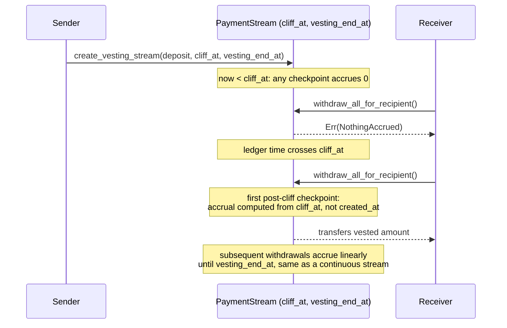

# ADR-0002: Payment Stream Design — Continuous, Milestone-Gated, and Vesting Modes

- Status: Accepted (Continuous, Milestone-Gated) / Proposed (Vesting — not yet implemented)
- Date: 2026-10-16

## Context

`fluxapay/src/stream.rs` implements `PaymentStream`, a continuous token-drip
primitive: a sender deposits a token balance that unlocks to a receiver at a
configurable `rate_per_second`. Streams were later extended with two
additional access-control hooks layered on top of the same struct:

1. A **milestone gate** — a boolean approval flag that blocks withdrawals
   until the sender explicitly signs off, used to model "pay only after a
   deliverable is approved" without redesigning the accrual model.
2. A **fixed withdrawal destination** — lets the receiver delegate "who can
   trigger a withdrawal" from "where the money goes."

This ADR documents the design decisions behind the current continuous +
milestone-gated implementation, the rate-change and cancellation semantics
that interact with both, and the proposed design for a third mode —
**vesting streams** (cliff + linear unlock) — which does not exist in the
codebase yet. Where a decision is still open, this ADR says so rather than
describing unbuilt behavior as implemented.

All three modes share one `PaymentStream` record and one accrual
checkpointing mechanism; they differ only in *when withdrawal is permitted*
and *how the unlock curve is shaped*, not in how tokens move.

## Decision

Keep a **single `PaymentStream` struct** with a checkpointed linear accrual
core, and layer each mode as an additional gate/shape on that core rather
than modeling `Continuous` / `Milestone` / `Vesting` as distinct contract
types or even as a `StreamType` enum on the struct. Concretely:

```rust
pub struct PaymentStream {
    pub stream_id: String,
    pub sender: Address,
    pub receiver: Address,
    pub destination: Option<Address>,   // fixed withdrawal destination (receiver-set)
    pub token: Address,
    pub rate_per_second: i128,
    pub min_rate_per_second: i128,
    pub remaining_deposit: i128,
    pub last_checkpoint_at: u64,
    pub accrued_at_checkpoint: i128,
    pub status: StreamStatus,           // Active | Cancelled | Exhausted | Paused
    pub milestones_approved: bool,      // withdrawal gate, not a milestone list
}
```

- **Continuous** is the base case: `milestones_approved` defaults to `true`
  at creation (`stream.rs`, stream construction path), so nothing about the
  accrual or withdrawal path changes unless a caller opts into gating.
- **Milestone-gated** sets `milestones_approved = false` at creation and
  requires `approve_stream_milestone` (sender-only) before
  `withdraw_all_for_recipient` / `batch_withdraw_to` / `trigger_withdrawal`
  will release funds. Accrual still happens continuously and silently in
  the background — gating only blocks the *withdrawal* step, not the
  accrual clock.
- **Vesting (proposed)** would reuse the same accrual core but replace the
  constant `rate_per_second` unlock with a cliff + linear-unlock curve
  computed from `created_at` and two new fields, `cliff_at: u64` and
  `vesting_end_at: u64`. No code for this exists today; see "Vesting
  Streams (Proposed)" below.

## Rationale: Why One Struct Instead of Three Stream Types

- **Rate-change, cancellation, pause/resume, and destination logic are
  identical across modes.** Splitting into separate contract types (or even
  separate structs) would require duplicating `decrease_rate_per_second`,
  `update_stream_rate`, `cancel_stream`, `pause_stream`/`resume_stream`, and
  `set_stream_destination` three times, with three sets of tests, for no
  behavioral difference in those paths.
- **A gate is cheaper and safer to extend than a tagged union.** Soroban
  `#[contracttype]` enums with large variant payloads increase WASM size and
  require careful handling in every match arm that touches `PaymentStream`.
  A single boolean (or, for vesting, two extra `u64` fields) keeps every
  existing function that doesn't care about the mode completely unaware
  that gating/vesting exists.
- **Storage migration risk.** Existing streams in persistent storage are
  `PaymentStream` values without a `stream_type` discriminant. Introducing
  one now would require a migration pass over all stored streams; keeping
  mode-specific behavior additive-only (new optional fields, defaulted for
  old streams) avoids that migration entirely.

## Milestone Streams — Why a Boolean Gate, Not an Off-Chain Oracle or an Evidence-Hash List

The original milestone design considered two richer alternatives before
landing on a single approval flag:

1. **Off-chain oracle attestation** — an oracle service posts a signed
   "milestone N complete" message that the contract verifies before
   unlocking. Rejected because it reintroduces the oracle trust and
   liveness dependency that `fx_oracle.rs` already isolates carefully for
   price data; milestone completion is a judgment call between sender and
   receiver, not an external fact an oracle can attest to without becoming
   an arbitrator. It would also add a second trusted-party dependency to a
   primitive whose entire value proposition is "sender and receiver settle
   directly."
2. **On-chain evidence-hash list** (a `Vec<(milestone_id, evidence_hash)>`
   checked off one by one, with partial unlocks per milestone) — rejected
   for the *current* iteration because it couples the stream's unlock curve
   to deliverable tracking that belongs in a higher-level escrow/invoice
   contract, not in the low-level drip primitive. `PaymentStream` already
   has a natural amount-based unlock (`rate_per_second`); forcing it to also
   carry a milestone schedule doubles the state machine's surface for a
   feature only a subset of streams need. Milestone *approval ordering* is
   intentionally simple as a result: there is no ordering, because there is
   only one gate — if finer-grained per-deliverable amounts are needed, the
   caller should compose multiple streams (one per milestone) rather than
   one stream with an internal milestone list.

The one-flag design pushes richer milestone tracking (what counts as
"done", evidence storage, partial-approval ordering) to the application
layer that calls `approve_stream_milestone`, while the contract only
enforces the binary withdrawal gate it can verify cheaply on-chain: has the
sender signed off, yes or no.

```mermaid
sequenceDiagram
    participant Sender
    participant Stream as PaymentStream (milestones_approved=false)
    participant Receiver

    Sender->>Stream: create_stream(..., milestones_approved=false)
    Note over Stream: accrual clock starts immediately;<br/>accrued_at_checkpoint grows every ledger
    Receiver->>Stream: withdraw_all_for_recipient()
    Stream-->>Receiver: Err(MilestoneNotApproved)
    Sender->>Stream: approve_stream_milestone(stream_id)
    Note over Stream: milestones_approved = true<br/>emits STREAM/MILESTONE_APPROVED
    Receiver->>Stream: withdraw_all_for_recipient()
    Stream-->>Receiver: transfers accrued_at_checkpoint
```

## Vesting Streams (Proposed — Not Yet Implemented)

No `cliff`, `vesting`, or linear-unlock code exists in `fluxapay/src/stream.rs`
or anywhere else in the contract today, and there is no
`stream_vesting_test.rs`. This section documents the intended design so
implementation can follow this ADR rather than invent the model ad hoc; it
is marked **Proposed**, not **Accepted**.

### Why checkpoint on cliff unlock, not at `create_stream` time

The continuous-stream accrual model checkpoints lazily: `accrued_at_checkpoint`
is only advanced when something touches the stream (a withdrawal, a rate
change, a pause). A vesting stream should **not** accrue anything before the
cliff timestamp passes — accrual before the cliff would let a receiver walk
away with a proportional amount even though the cliff's entire purpose is
"nothing vests until this date." The proposed rule is:

- Before `cliff_at`: any checkpoint operation computes `newly_accrued = 0`
  regardless of elapsed time.
- At or after `cliff_at`: the **first** checkpoint after the cliff passes
  computes accrual as if the stream had been running since `cliff_at` (not
  since `created_at`), then proceeds exactly like a continuous stream's
  linear accrual for every checkpoint after that.

Checkpointing *at* cliff unlock (lazily, on first post-cliff touch) rather
than scheduling an on-chain timer at `create_stream` time avoids needing any
cross-call scheduling primitive — Soroban contracts have no native "wake me
up later" mechanism, so the lazy-checkpoint pattern already used for
continuous streams naturally extends to vesting with no new infrastructure.

### Why linear unlock after the cliff, not milestone-style tranches

A linear unlock after the cliff keeps the vesting curve expressible with
the same two numbers the continuous model already uses
(`rate_per_second`, `remaining_deposit`) plus the two new timestamps
(`cliff_at`, `vesting_end_at`), instead of a tranche schedule that would
need its own list type. `rate_per_second` for a vesting stream is derived
once at creation as `remaining_deposit / (vesting_end_at - cliff_at)`
rather than supplied directly by the caller.



### Interaction with rate changes

A vesting stream's "rate" is derived, not caller-supplied, so
`update_stream_rate` / `decrease_rate_per_second` would need to either (a)
reject calls on vesting streams and require re-deriving the rate through a
dedicated `adjust_vesting_schedule` entry point that also validates the new
`vesting_end_at`, or (b) allow a rate override that detaches the stream
from its original end date. Option (a) is the leaning design choice: it
keeps `rate_per_second` changes meaning the same thing ("the deposit drains
at this rate") for every stream, continuous or vesting, and keeps schedule
edits auditable through one obviously-named function instead of overloading
the generic rate-change path with vesting-specific side effects.

## Rate-Change Interaction — Why Decreases Must Checkpoint First

Both `decrease_rate_per_second` and `update_stream_rate`
(`fluxapay/src/stream.rs`) checkpoint accrual **before** applying the new
rate:

1. `elapsed = now - last_checkpoint_at`
2. `newly_accrued = elapsed * old_rate`, clamped so
   `accrued_at_checkpoint` never exceeds `remaining_deposit`
3. `accrued_at_checkpoint += newly_accrued`, `last_checkpoint_at = now`
4. *Then* the rate is changed and, for a decrease, the surplus is computed
   and refunded to the sender.

This ordering is load-bearing, not incidental. If the rate were changed
*before* checkpointing, the `elapsed * rate` calculation in the next
checkpoint would retroactively apply the **new** rate to time that already
passed at the **old** rate — silently changing how much the receiver was
owed for time already elapsed. Checkpointing first freezes everything
accrued under the old rate as an immutable fact (`accrued_at_checkpoint`),
so the rate change can only affect accrual from `now` forward:

```mermaid
sequenceDiagram
    participant Sender
    participant Stream

    Note over Stream: old_rate active since last_checkpoint_at
    Sender->>Stream: decrease_rate_per_second(new_rate)
    Stream->>Stream: checkpoint(): accrued_at_checkpoint += elapsed * old_rate
    Stream->>Stream: remaining_unlocked = remaining_deposit - accrued_at_checkpoint
    Stream->>Stream: old_seconds_left = remaining_unlocked / old_rate
    Stream->>Stream: new_needed = old_seconds_left * new_rate
    Stream->>Stream: surplus = remaining_unlocked - new_needed
    Stream->>Stream: remaining_deposit -= surplus; rate_per_second = new_rate
    Stream-->>Sender: transfers surplus back
    Note over Stream: STREAM/RATE_DECREASED(stream_id, sender, old_rate, new_rate, surplus)
```

A decrease must also satisfy `new_rate < old_rate` (else
`Error::RateNotDecreased`) and `new_rate >= min_rate_per_second` (else
`Error::RateBelowMinimum`) — the latter exists so a sender cannot grief a
receiver by decreasing the rate toward zero and stretching the stream out
indefinitely; `min_rate_per_second` is fixed at creation and is itself
immutable. `update_stream_rate` allows increases too, with no surplus
refund (the deposit simply drains faster) and the same checkpoint-first
ordering.

## Destination Accounts — Why a Fixed, Receiver-Set Withdrawal Destination

`set_stream_destination` (receiver-only auth) lets the receiver nominate a
fixed `destination: Option<Address>` that is *where* funds land, decoupled
from *who* can trigger the withdrawal. Once set, `trigger_withdrawal` is
permissionless — anyone (a cron bot, the sender, a relayer) can call it to
sweep accrued funds to the receiver's chosen destination. This split exists
because:

- Receivers often want withdrawals automated (e.g. by a backend job) without
  handing that job custody of where the money goes — the destination is
  locked by the receiver in advance, so a compromised or malicious trigger
  caller can only *time* withdrawals, never *redirect* them.
- It avoids a receiver having to keep a hot signing key around purely to
  call withdraw periodically; any address can pay the transaction cost to
  trigger it.

Setting a destination requires the stream to be `Active` and rejects
`destination == sender` (a sender cannot quietly redirect their own
outgoing stream back to themselves through the receiver's destination
slot).

## Cancellation Semantics — Accrued vs. Unaccrued

`cancel_stream`, `cancel_multiple_streams`, and `batch_cancel_streams` all
apply the same split:

```rust
let accrued = stream.accrued_at_checkpoint;
let refund = stream.remaining_deposit.saturating_sub(accrued);
stream.status = StreamStatus::Cancelled;
stream.remaining_deposit = accrued;
// transfer `accrued` to receiver, transfer `refund` to sender
```

- **Accrued-but-unwithdrawn** amounts belong to the receiver and are paid
  out immediately on cancellation — the receiver already earned this time
  under the stream's rate; cancellation stops future accrual, it does not
  claw back the past.
- **Unaccrued deposit** (everything beyond what's accrued) returns to the
  sender — it was never owed to the receiver.
- State is persisted (`status = Cancelled`, `remaining_deposit = accrued`)
  *before* either transfer executes (checks-effects-interactions), so a
  reentrant call during the token transfer sees an already-cancelled,
  zero-further-liability stream.
- `STREAM/CANCELLED` is emitted with `(stream_id, sender, accrued, refund)`
  so off-chain indexers can reconcile both halves of the split without
  re-deriving them.

For a milestone-gated stream, cancellation deliberately does **not** check
`milestones_approved`: accrued funds are still paid to the receiver on
cancellation even if the sender never approved a withdrawal, because the
gate controls *withdrawal timing*, not *entitlement* — the receiver earned
the accrued balance by the clock, same as a continuous stream; approval
only ever gated when they could pull it out while the stream was active.
For a vesting stream (proposed), the same split would apply using whatever
has vested as of the cancellation timestamp as `accrued`; anything still
locked behind an unreached cliff or future linear-unlock portion returns to
the sender as `refund`.

## Decision Table — When to Use Each Mode

| Mode | Unlock shape | Use when | Gate / schedule |
|---|---|---|---|
| Continuous | Constant `rate_per_second` from creation | Payroll, subscriptions, ongoing service fees — value is delivered continuously and should be withdrawable continuously | None — `milestones_approved = true` by default |
| Milestone-gated | Same constant-rate accrual, withdrawal blocked until approved | Freelance/contract work where payment should be held until the sender confirms a deliverable, but you still want a simple, auditable unlock clock running underneath | Single sender-controlled boolean flag (`approve_stream_milestone`) |
| Vesting (proposed) | Zero until `cliff_at`, then linear to `vesting_end_at` | Token grants, equity-style compensation, or any arrangement with an explicit "nothing before date X, then gradual" curve | Two fixed timestamps set at creation; no manual approval step |

## Consequences

- Pros: One accrual engine to audit and test; new modes (milestone gate,
  proposed vesting) are additive fields/flags rather than new contract
  surfaces; rate-change, cancellation, pause/resume, and destination logic
  is shared and only needs to be correct once.
- Cons: `PaymentStream` accumulates mode-specific fields over time
  (`milestones_approved` today, `cliff_at`/`vesting_end_at` if vesting
  ships), and functions that are mode-agnostic still have to reason about
  whether a gate or schedule field applies to them; there is no
  `StreamType` discriminant to pattern-match on, so each new mode needs its
  own prose-documented interaction rules (as in this ADR) rather than a
  compiler-enforced exhaustiveness check.

## Revisit Trigger

If a third or fourth mode is proposed that needs its own multi-field
schedule (not just one or two extra fields) or its own cancellation/refund
math that doesn't fit the accrued-vs-unaccrued split in this ADR, revisit
whether `PaymentStream` should become a tagged union (or separate contract)
per mode instead of continuing to layer fields onto one struct.

## Implementation Pointers

- `fluxapay/src/stream.rs` — `PaymentStream`, `create_stream`,
  `approve_stream_milestone`, `set_stream_destination`,
  `decrease_rate_per_second`, `update_stream_rate`, `cancel_stream`,
  `cancel_multiple_streams`, `batch_cancel_streams`, `trigger_withdrawal`,
  `withdraw_all_for_recipient`, `batch_withdraw_to`.
- `fluxapay/src/stream_test.rs` — coverage for continuous accrual, rate
  changes, milestone gating, destination routing, and cancellation splits.
- A future `fluxapay/src/stream_vesting_test.rs` does not exist yet; it
  should be added alongside the vesting implementation proposed above.
